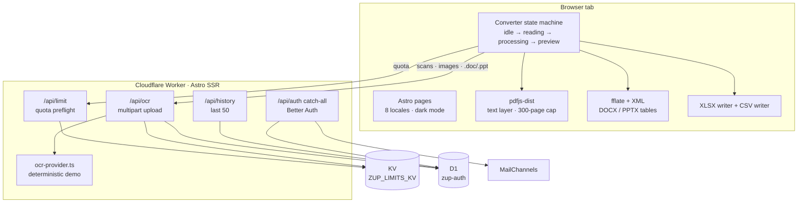

<div align="center">

<h1>📄 ZeroUploadPDF</h1>

<strong>A privacy-first PDF → Excel/CSV converter that parses native documents in your browser and previews the table before you download.</strong>

<br /><br />


</div>

---

<div align="center">

[What it is](#-what-it-is) · [Features](#-key-features) · [Architecture](#-architecture) · [Tech stack](#-tech-stack) · [Quick start](#-quick-start) · [Structure](#-project-structure) · [Status](#-status--known-gaps) · [Contributing](#-contributing)

</div>

---

## 🎯 What it is

ZeroUploadPDF turns documents into spreadsheets. Drop in a PDF, Word file, PowerPoint deck, PNG or JPG; get a table preview and a real `.xlsx` workbook or `.csv` back. Text-based PDFs and native DOCX/PPTX are unpacked and parsed in the browser tab — their bytes never touch a server. Scanned PDFs, images and legacy `.doc`/`.ppt` files take the server OCR route, which is the one place a file leaves the machine.

The repository is the full product surface, not a widget: a long-form landing page, a converter with explicit idle/reading/processing/preview/error states, pricing and FAQ, legal pages, eight locales, light/dark themes, Better Auth/D1 account plumbing, D1-backed history and a KV-backed daily quota. It runs as an Astro app on Cloudflare Workers.

> **Important:** the converter, native parsers, XLSX writer and Cloudflare plumbing are real. The OCR provider in `src/server/ocr-provider.ts` is a deterministic demo, and Pro checkout/batch conversion are marketing copy. See [Status & known gaps](#-status--known-gaps).

## ✨ Key Features

- **Native PDF parsing in the tab** — `pdfjs-dist` reads the text layer page by page (300-page cap), groups text items into lines by Y proximity and columns by X gaps, and builds one sheet per page. No upload, no server round-trip.
- **DOCX and PPTX without Office** — `fflate` unzips the OOXML container and a focused XML reader pulls table rows and cells. DOCX falls back to paragraph lines when there are no tables; PPTX reads slide tables and falls back to slide text, with page/slide counts derived from the document.
- **Scanned-PDF fallback** — a native PDF that produces no text is automatically retried through the OCR path. PNG, JPG, `.doc` and `.ppt` go straight to OCR; the client enforces a 100 MB guardrail before anything is read.
- **A real XLSX writer, no SheetJS** — `src/lib/core/xlsx.ts` builds the OOXML package directly with `fflate`: content types, workbook relationships, per-sheet worksheets, inline strings, XML escaping and 31-character sheet-name sanitizing. Multi-sheet inputs export as a multi-tab workbook.
- **Correct CSV quoting** — commas, quotes and newlines are escaped; CSV export takes the first non-empty sheet, while XLSX keeps every non-empty sheet.
- **Preview before commit** — the first sheet's header and first 12 body rows render in a table, with a `Native · in browser` or `OCR · server-side` path tag, sheet name, row count and OCR confidence.
- **10 conversions a day, enforced at the edge** — KV keys are `conv:${fingerprint}:${UTC date}`, with the fingerprint derived from the signed-in user id or the request IP. The TTL expires at the next UTC midnight. A `plan === 'pro'` user bypasses the counter.
- **Accounts and history scaffolding** — Better Auth email/password with Drizzle on D1, email verification and password reset through MailChannels, session-aware `/api/account`, and `/api/history` returning the signed-in user's last 50 recorded conversions (the OCR endpoint is what writes rows today).
- **Eight locales** — English, Spanish, Japanese, French, German, Portuguese, Korean and Italian, with translated marketing pages, canonical URLs and `hreflang` alternates. English stays unprefixed.
- **A deliberate visual system** — warm paper/ink tokens, one data-green accent, amber only for OCR, self-hosted Space Grotesk/Inter/IBM Plex Mono, a pre-paint theme toggle and `prefers-reduced-motion` support.
- **Tests with receipts** — `TEST-REPORT.md` records 68/68 unit tests across 9 files and 93.95% line coverage; `QA-AUDIT.md` records 19/19 Playwright checks, including 360/768/1024/1440 overflow and console-error sweeps.

## 🏗️ Architecture



- **`src/lib/core/formats.ts`** — the single format registry: extensions, MIME types, native-vs-image kind, page/slide units, and the `TableRow`/`TableSheet` types every other module shares.
- **`src/lib/core/pdf.ts`** — dynamic `pdfjs-dist` import, worker URL via Vite `?url`, `maxPages = 300`, empty-page confidence scoring and deterministic teardown.
- **`src/lib/core/ooxml.ts`** — container validation, DOCX table/paragraph extraction, PPTX slide/table/text extraction, page-break counting and slide ordering.
- **`src/lib/core/tables.ts`** — PDF text-item grouping (`yTolerance`, `xGapPx`, PDF’s descending Y axis), row construction and comma/quote/newline-safe CSV quoting.
- **`src/lib/core/xlsx.ts`** — a small, dependency-free OOXML writer. It is intentionally not a full spreadsheet engine: values are inline strings, with no formulas, styles or number formats.
- **`src/lib/core/pipeline.ts`** — routes a format key to native PDF, OOXML or the injected OCR transport, and normalizes failures into `no-text`, `bad-container`, `ocr-failed` and `unsupported`.
- **`src/scripts/converter.ts`** — the client state machine: drag/drop, 100 MB guard, quota preflight, native→OCR fallback, 12-row preview, and Blob downloads.
- **`src/pages/api/`** — `limit.ts` (GET usage / POST consume), `ocr.ts` (multipart upload, quota, history write), `history.ts`, `account.ts` and the Better Auth catch-all.
- **`src/lib/account.ts` + `src/lib/limits.ts`** — account resolution, Pro bypass, UTC-day keys, TTLs and the pure limit evaluation used by the unit tests.
- **`src/server/ocr-provider.ts`** — the recognition boundary. Today it returns `demoOcrResult(16)`: the same 16-row sample invoice on every non-empty upload. Replace this function to ship real OCR; the transport contract stays the same.
- **`src/auth/` + `src/db/auth-schema.ts`** — Better Auth config and the Drizzle schema for `user`, `session`, `account`, `verification` and `conversion`.
- **`src/i18n/`** — seven locale dictionaries plus the English source; `astro.config.mjs` declares all eight locales with English unprefixed.

## 🧰 Tech Stack

| Layer | Choice | Version in manifest |
|---|---|---|
| Framework | Astro | `^7.3.1` |
| Deploy adapter | `@astrojs/cloudflare` | `^14.3.0` |
| Styling | Tailwind CSS via `@tailwindcss/vite` | `^4.3.3` |
| Language | TypeScript | `^6.0.3` |
| PDF parsing | `pdfjs-dist` | `^6.3.289` |
| ZIP / OOXML | `fflate` | `^0.8.3` |
| Auth | `better-auth` + Drizzle adapter | `^1.7.2` |
| Database | Cloudflare D1 + `drizzle-orm` | `^0.45.2` |
| Quota | Cloudflare KV (`ZUP_LIMITS_KV`) | binding |
| Email | MailChannels HTTP API | runtime `fetch` |
| Edge tooling | Wrangler | `^4.129.0` |
| Unit tests | Vitest + `@vitest/coverage-v8` | `^5.0.0` |
| E2E | Playwright | `^1.63.0` |
| Runtime | Node.js | `>=22.12.0` |
| Fonts | Space Grotesk, Inter, IBM Plex Mono | Fontsource |

## 🚀 Quick Start

**Prerequisites:** Node.js `>=22.12.0` and npm. The Cloudflare bindings are declared in `wrangler.jsonc`; local runs use Miniflare.

```bash
npm install
npx wrangler d1 migrations apply zup-auth --local
npm run dev               # http://localhost:4321
```

For a Workers-faithful local run of the built app:

```bash
npm run build
npx wrangler dev
```

### Configuration

Create `.dev.vars` for local secrets (the checkout already has one; keep real keys out of version control).

| Variable | Required | What it does |
|---|---|---|
| `BETTER_AUTH_SECRET` | For auth | Signing secret for Better Auth sessions. |
| `BETTER_AUTH_URL` | For auth | Public origin. `wrangler.jsonc` sets `https://zerouploadpdf.com`; use `http://localhost:4321` locally. |
| `AUTH_EMAIL_SENDER` | For real email | From-address passed to MailChannels for verification/reset mail. |
| `AUTH_EMAIL_PROVIDER` | No | `mailbox` in `wrangler.jsonc`; `console` logs instead of sending. |
| `AUTH_MAILBOX_URL` | Tests only | Capture endpoint used by `ZUP_TEST_MODE`/mailbox flows. |
| `ZUP_TEST_MODE` | No | `1` enables the quota reset test hook; leave `0` in production. |

| Binding | Type | Purpose |
|---|---|---|
| `DB` | D1 (`zup-auth`) | Auth tables + conversion history; migrations in `migrations/`. |
| `ZUP_LIMITS_KV` | KV | Per-fingerprint daily conversion counter. |
| `ASSETS` | Workers Assets | `./dist/client`, served with `run_worker_first: true`. |

### Scripts

| Command | What it does |
|---|---|
| `npm run dev` | Astro dev server on `4321`. |
| `npm run build` | Production build to `dist/`. |
| `npm run preview` | Astro preview of the build. |
| `npm test` | Vitest unit suite (`vitest run`). |
| `npm run test:coverage` | Unit tests + V8 coverage. |
| `npm run test:e2e` | Playwright E2E; run `npx playwright install chromium` first. |
| `npm run astro -- check` | Astro/TypeScript diagnostics. |
| `npx wrangler deploy` | Deploy the built Worker with the D1/KV bindings. |

## 📁 Project Structure

```text
Zerouploadpdf/
├── src/
│   ├── components/              # Hero, Converter, PricingSection, FAQ, header/footer
│   ├── pages/                   # /, /convert, /pricing, legal pages
│   │   ├── api/                 # limit, ocr, history, account, auth catch-all
│   │   └── [locale]/            # 7 translated marketing page sets
│   ├── lib/
│   │   ├── core/                # formats, pdf, ooxml, tables, xlsx, pipeline
│   │   ├── ocr/                 # browser → /api/ocr transport
│   │   └── account.ts, limits.ts, email.ts
│   ├── server/ocr-provider.ts   # recognition boundary (currently a demo)
│   ├── auth/                    # Better Auth config + types
│   ├── db/auth-schema.ts        # Drizzle schema for D1
│   ├── i18n/                    # en + es, ja, fr, de, pt, ko, it
│   ├── layouts/                 # BaseLayout (SEO/i18n) + starter Layout
│   ├── scripts/                 # converter state machine, theme boot
│   └── styles/global.css        # Tailwind 4 theme tokens
├── migrations/                  # 0000 auth core, 0001 history
├── tests/
│   ├── unit/                    # 9 Vitest files
│   ├── e2e/                     # converter + QA specs
│   └── fixtures/                # generated PDF/DOCX/PPTX/PNG samples
├── public/                      # favicon, OG card, robots, sitemap
├── astro.config.mjs             # i18n + Cloudflare adapter
├── wrangler.jsonc               # D1, KV, assets, vars, observability
├── drizzle.config.ts
├── vitest.config.ts
├── playwright.config.ts
└── package.json
```

## 📌 Status & known gaps

- **The OCR endpoint is a demo.** `src/server/ocr-provider.ts` ignores the uploaded bytes (apart from an empty-file check) and returns `demoOcrResult(16)` — the same 16-row sample invoice, 1 page, 88% confidence — for every non-empty upload. There is no real text recognition, no provider SDK and no per-file result. The UI copy about scanned files is the intended product behavior, not what this checkout implements.
- **Pro and batch are marketing-only.** There is no Stripe SDK, checkout route or webhook. The pricing CTA points at `/convert`, and `plan` is a string on the D1 user row whose only effect is bypassing the KV counter (`plan === 'pro'`). Batch conversion (up to 20 files) and the 400-page Pro ceiling exist in `src/data/site.ts` copy; neither is implemented. The native PDF parser caps at 300 pages.
- **Quota accounting double-counts OCR.** The converter calls `POST /api/limit` before conversion, and `POST /api/ocr` calls `consumeUsage` again, so a scan or image can burn two of the ten daily units while a native file burns one. This is a code-level quirk, not intended behavior.
- **Auth is partially wired.** The Better Auth backend, Drizzle schema, `/api/auth/[...all]` route and session-aware account/history endpoints exist. The account UI is unfinished: `src/components/AuthCard.astro` contains placeholder/duplicate declarations (for example, a duplicate `export const AuthCard` and an undefined `response`), and the auth pages under `src/pages/` import `../../layouts`/`../../components`, which resolves outside `src/`. Treat sign-in, sign-up and account as work in progress, and re-check a clean `npm run build` after fixing those imports.
- **Tests are quoted from the reports.** `TEST-REPORT.md` (2026-09-05) records 68/68 unit tests and 93.95% line coverage; `QA-AUDIT.md` records 19/19 Playwright checks. This checkout has no `node_modules`, so they were not re-run here. There are no `.github` workflows checked in.
- **No LICENSE file.** The code is not under an open-source license by default.

## 🤝 Contributing

Contributions are welcome — especially a real OCR provider, auth UI completion, additional table-reconstruction fixtures and accessibility passes.

1. Read `DESIGN.md` before changing UI. The palette, type scale, spacing and motion rules are a contract, not suggestions.
2. Add a new input format in `src/lib/core/formats.ts`, route it in `pipeline.ts`, and cover both the registry and the extraction path in `tests/unit/`.
3. Keep the zero-upload promise honest: native PDF/DOCX/PPTX bytes must stay in the browser. Only the OCR transport may send a file.
4. To ship real OCR, implement `recognize()` in `src/server/ocr-provider.ts` and keep the existing `{ sheets, pages, confidence }` response shape so `pipeline.ts` and the converter do not change.
5. Run `npm test`, `npm run test:coverage`, `npm run test:e2e` and `npm run build` before opening a PR. Add a `LICENSE` file before redistributing the code.

---

<div align="center">

⭐ If you find this project useful, consider giving it a star!

**[github.com/Manav57/Zerouploadpdf](https://github.com/Manav57/Zerouploadpdf)**

</div>
